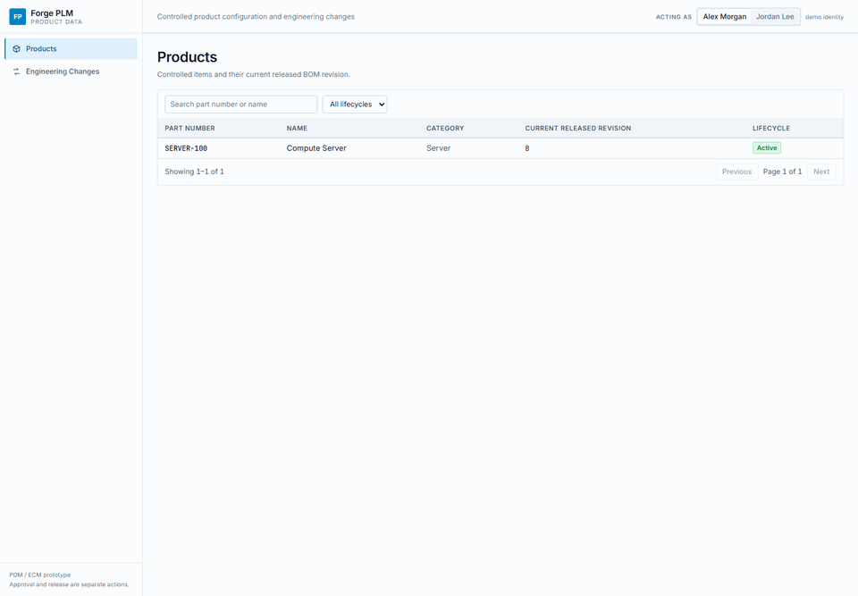
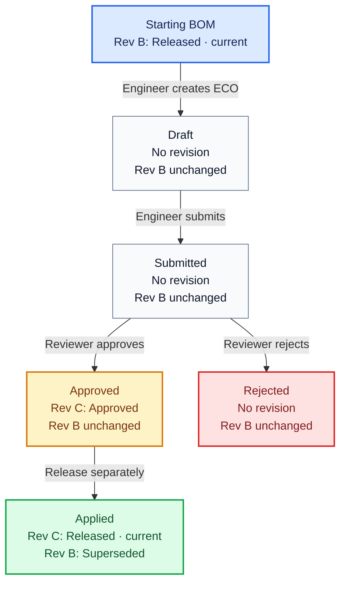
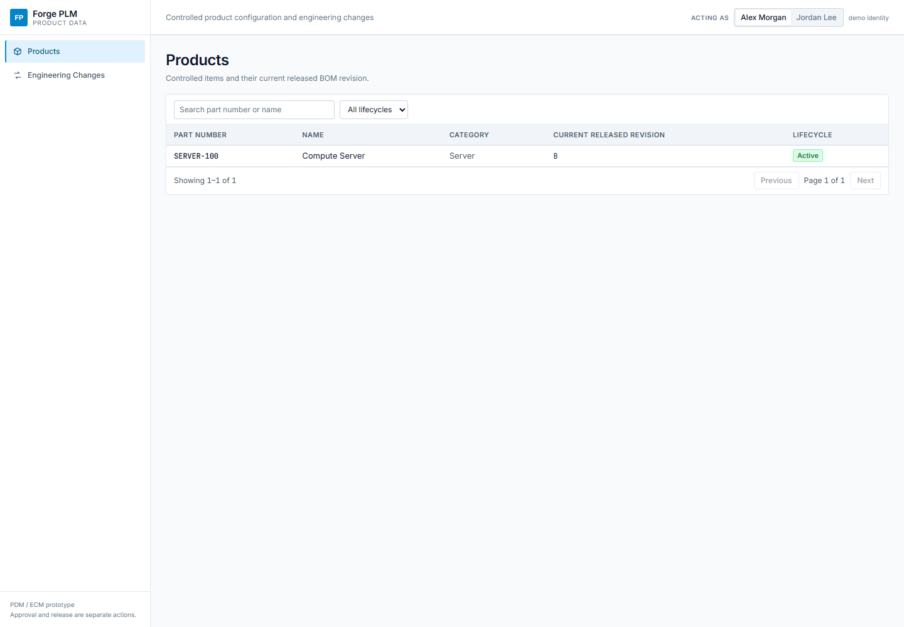
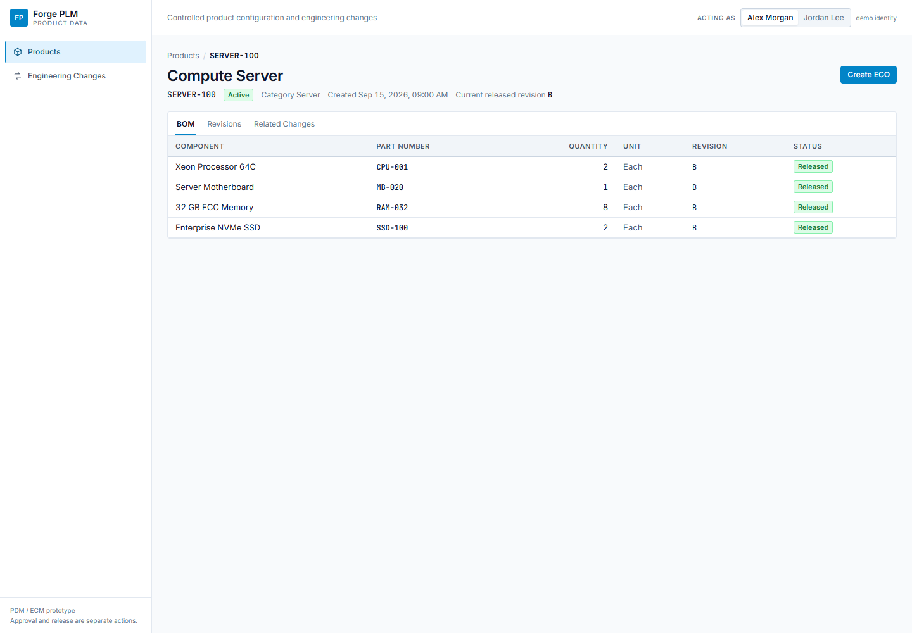
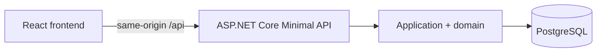

# Forge PLM Engine

**Controlled product configurations, with every proposed BOM change reviewed before release.**

Forge PLM is a .NET and React prototype for managing product configurations, BOM revisions, and Engineering Change Orders (ECOs). Approval creates a candidate revision; release makes it the current released configuration. Previous revisions remain available for historical traceability.



## Follow a change through the app

Start with the seeded `SERVER-100` product at released revision B. Propose replacing motherboard `MB-020` with `MB-021`, submit the ECO, review the exact BOM difference, approve it, then release the approved revision when it is ready.



The ECO detail page keeps the request, BOM comparison, workflow state, and audit history together.

## Screens

The screenshots below show the implemented frontend with a fixed demo fixture aligned to the `SERVER-100` workflow. They illustrate the UI and sample data; they are not a recording of a live database session.

| Product catalog | Released bill of materials |
| --- | --- |
|  |  |
| Search and filter the product catalog, then open a product. | Inspect the released component list and start an ECO from its baseline. |

The ECO review screen above shows a submitted motherboard replacement. The blue row highlights what changes from revision B to the proposed configuration; the audit trail records creation and submission.

## What the prototype covers

- Product and component catalog reads, with lifecycle status and paged search.
- API-only initial BOM setup for a new active product, followed by ECO-controlled revisions.
- Released BOM revisions and their component lines.
- ECO drafts with component replacement or quantity changes.
- Draft editing, submission, approval, rejection, and release.
- Before-and-after BOM comparison and append-only application audit events.
- PostgreSQL persistence, EF Core migrations, and demo baseline seeding.

Catalog creation is available through the API, not the UI. A new active product can receive its first released BOM through `POST /api/products/{productId}/bom-revisions/initial`; later revisions must use ECOs. The acting person selector is a demo identity supplied by the client, not authentication or authorization. See [current implementation status](docs/STATUS.md) for known gaps.

## Run the demo

Requirements: Docker with Compose, .NET SDK 10 for backend development, and Node.js 20.19+ or 22.12+ for frontend development.

From the repository root:

```sh
docker compose up -d --build --wait
```

Open <http://localhost:5199/>. The first start migrates the database and seeds the baseline product, components, released revision B, and audit events. Startup seeding is idempotent.

Stop the containers and keep the database volume with `docker compose down`. To also remove the data, run `docker compose down -v`.

### Stack

- .NET 10 and ASP.NET Core Minimal APIs
- C# and Entity Framework Core
- PostgreSQL
- React and TypeScript
- Docker Compose
- xUnit and Vitest

### Prototype limitations

Release takes effect immediately. Scheduled future effectivity is unsupported; when an ECO requests a future date, the reviewer can release now or cancel. The release time (`ReleasedAtUtc`) and effective time (`EffectiveAtUtc`) are recorded separately; both are current UTC for a prototype release.

### Develop and check

For local backend development, keep PostgreSQL running with `docker compose up -d db`, then run:

```sh
dotnet run --project src/ForgePlm.Api -- --urls http://localhost:5199
```

In another terminal, start the frontend dev server:

```sh
cd frontend
npm ci
npm run dev
```

The frontend is at <http://localhost:5173/> and proxies `/api` to the backend on port 5199. Run frontend checks from `frontend/` with `npm test`, `npm run build`, or `npm run coverage`. The backend suite runs from the repository root with `dotnet test ForgePlm.slnx`; `./coverage.ps1` collects .NET coverage.

The [ECO API contract](docs/ECO-API-CONTRACT.md) documents API routes and lifecycle behavior. [Current status](docs/STATUS.md) records implementation boundaries and the latest verification state.

## How it fits together



The API serves the built frontend and JSON endpoints from one origin. PostgreSQL and EF Core enforce persistence constraints, including unique part numbers and revision concurrency. The backend is organized around products, components, BOM revisions, ECO workflows, and audit records.

## Project guide

- [Forge PLM Specification](docs/Forge-PLM-Spec.md) — product behavior, domain model, lifecycle, and demo scenario.
- [Current status and developer commands](docs/STATUS.md) — implementation boundaries, setup, and checks.
- [ECO API contract](docs/ECO-API-CONTRACT.md) — request and response shapes, status codes, and lifecycle behavior.
- [Architecture decisions](docs/DECISIONS.md) — rationale behind key implementation choices.
- [Concurrency decision record](docs/adr/ADR-004-concurrency-xmin-partial-index.md) — PostgreSQL revision concurrency and uniqueness rules.
