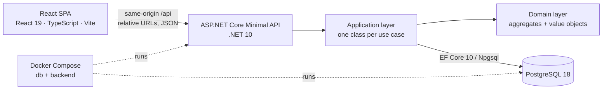
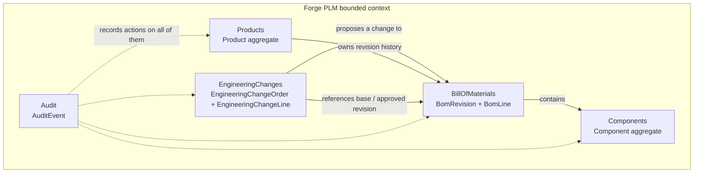
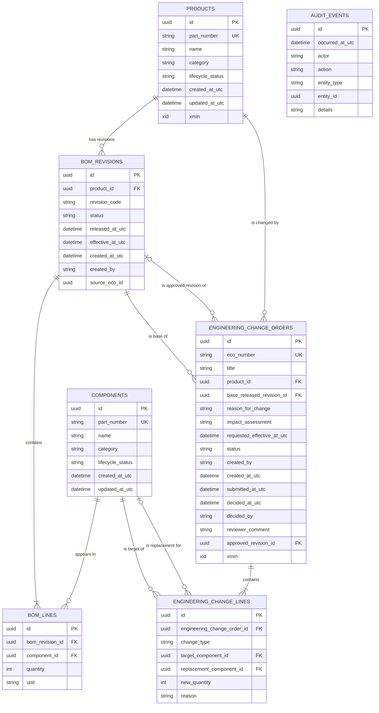
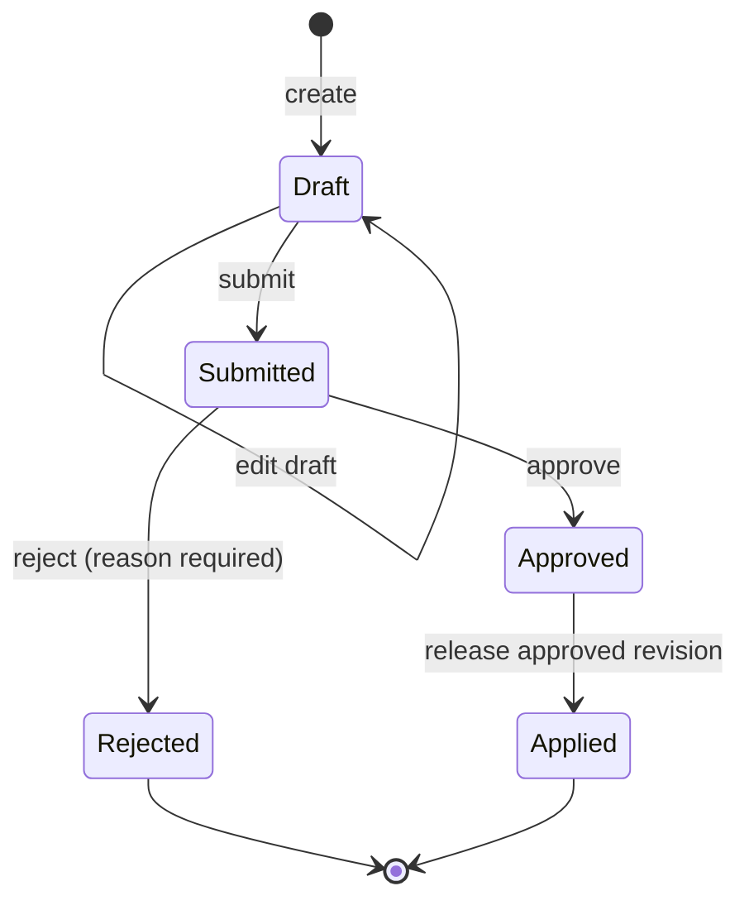
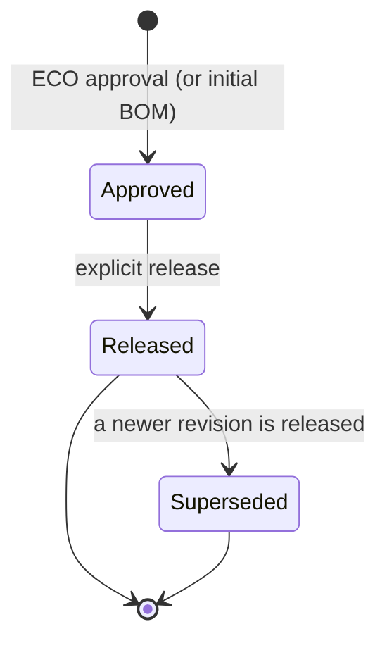
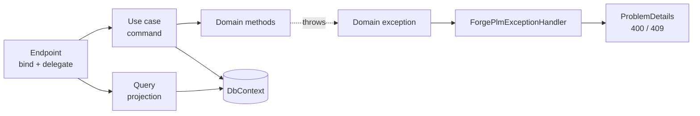
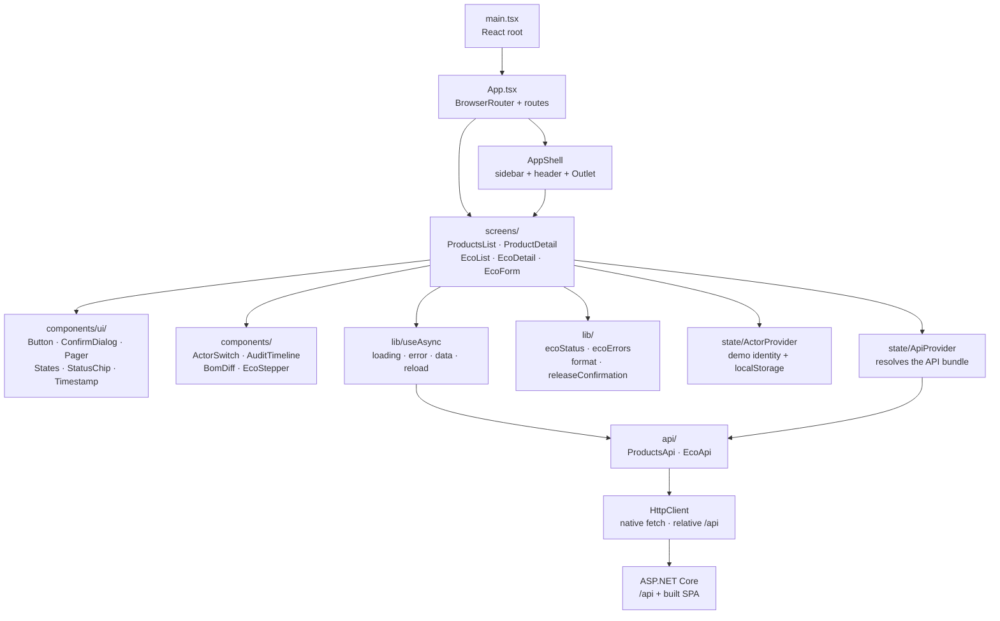
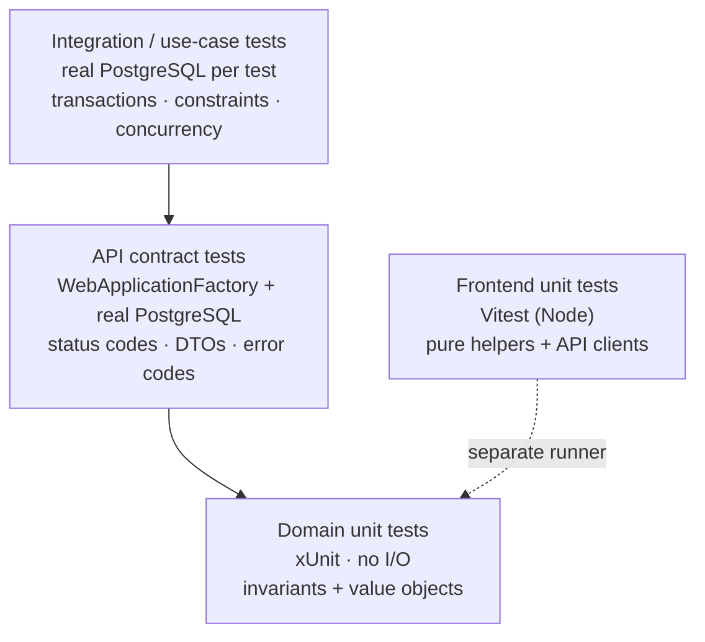
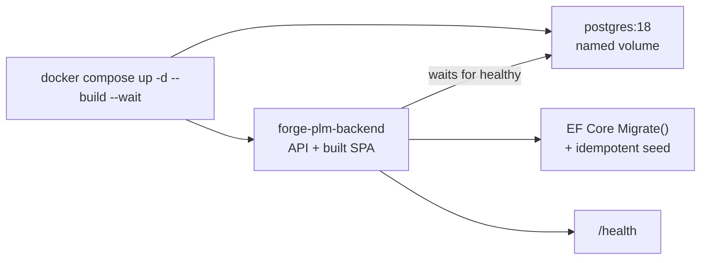

# Forge PLM — Architecture Notes

This document explains how the prototype is put together and why. It is written to be read
before an interview: each section states the decision, the mechanism in the code, and the
trade-off you should be able to defend.

Companion documents:

- [Specification](SPECIFICATION.md) — product scope, domain language, use cases.
- [Implementation reference](IMPLEMENTATION.md) — status, API contract, implementation decisions, and the ADR-004 concurrency record.

---

## 1. System at a glance

Forge PLM is a **modular monolith**: one deployable ASP.NET Core process, one PostgreSQL
database, and one React single-page application served by that same process in demo mode.



Two runtime facts matter:

1. **Development** runs Vite on `:5173` and proxies `/api` to the API on `:5199`.
2. **Demo/run** builds the SPA into the API's `wwwroot`, so browser routes and `/api` share one
   origin. There is no CORS configuration anywhere because there is no cross-origin request.

The backend is split into two projects:

```text
src/
  ForgePlm.Domain/   # no EF Core, no ASP.NET, no HTTP, no persistence types
  ForgePlm.Api/      # Minimal APIs, application use cases, EF Core, migrations, seed
tests/
  ForgePlm.Tests/    # xUnit: domain, API contract, PostgreSQL integration
frontend/
  src/               # React SPA
```

`ForgePlm.Domain` referencing nothing is enforced socially, not by an analyzer — but it is the
rule that keeps the domain testable without a database and keeps business rules out of React and
out of endpoint delegates.

---

## 2. Architectural decisions

| Decision | Choice | Why | Cost / trade-off |
|---|---|---|---|
| Deployment style | Modular monolith, one API process | The problem is one product-configuration domain; distribution would add failure modes without a requirement | Cannot scale modules independently; fine for the stated scope |
| Module boundaries | Folders by capability, not separate projects | `Products`, `Components`, `BillOfMaterials`, `EngineeringChanges`, `Audit` fit in one head | Boundaries are conventions, not compiler-enforced assemblies |
| Domain isolation | `ForgePlm.Domain` has zero package references | Rules are testable in isolation; the domain cannot accidentally query the DB | Cross-aggregate checks must live in application services |
| Persistence | One `ForgePlmDbContext`, no repository/UoW abstraction | EF Core already is the unit of work. A generic repository would add indirection with no second implementation | Application services are coupled to EF Core; accepted deliberately |
| Write model | One application service class per command (`CreateEngineeringChange`, `ApproveEngineeringChange`, …) | Each use case has an explicit transaction boundary and a name you can point at | More small classes than a god-service |
| Read model | Static query classes returning DTOs (`EcoQueries`, `AuditQueries`, endpoint projections) | Reads do not need aggregates; projections avoid exposing tracked entities and avoid N+1 | Not a CQRS framework — command/query separation in code only |
| API style | Minimal APIs grouped by feature (`MapEcoEndpoints`, …) | Lowest ceremony; endpoints stay thin | No controller conventions/filters; cross-cutting concerns are explicit middleware/handler |
| Error contract | RFC 7807 `ProblemDetails` with stable `code`/`conflictType` | UI reacts to machine codes, not prose; one mapper owns the mapping | Adding a domain code is an API contract change |
| Database | PostgreSQL 18 only, no dual-provider abstraction | `xmin`, partial unique indexes, and real transactions are part of the design | Deliberately provider-specific |
| Concurrency | Optimistic concurrency via `xmin` + database invariants | Database is the witness; no hand-maintained version column | PostgreSQL-specific; conflicts surface as `409` |
| History | Immutable BOM revisions; supersede, never overwrite | Product history must remain explainable after a change | More rows; current revision must be derived |
| Approval vs release | Two separate use cases | Approval authorizes a configuration; release makes it effective | Two actions for the user, which is the point |
| Audit | Append-only `audit_events`, written in the same transaction | A record of what happened without becoming the source of truth | Not event sourcing; no replay |
| Authentication | None; client-supplied actor switch | Demo scope; production identity belongs in claims | Actor is **not** a security control |
| Frontend state | No Redux/Zustand/React Query; two contexts + `useAsync` | The app has one user, short-lived screens, no cache needs | Every navigation refetches; not a large-app data layer |
| Styling | Tailwind CSS 4 compiled at build time, design tokens in `styles.css` | Dense, consistent UI without a component library | Markup is verbose; tokens must be kept aligned with the mockup |
| Testing | xUnit + real PostgreSQL; Vitest in Node for pure TS | Honest relational tests; fast frontend unit tests | No browser/E2E suite; UI screens are not covered |

Explicitly **not** used, and worth saying why in an interview: MediatR, AutoMapper, a generic
repository layer, a domain-event framework, event sourcing, a workflow engine, microservices,
message brokers, and an in-memory EF provider for tests.

---

## 3. DDD: bounded context and modules

There is **one bounded context** — engineering change management for a single product
configuration domain. Inside it, code is organised by capability:



These are **modules, not separate deployables or separate databases**. A true bounded context
would be relevant if, say, purchasing had its own model of a part with different rules. Here the
same part number means the same thing everywhere.

### Tactical DDD patterns actually used

- **Entities**: `Product`, `Component`, `BomRevision`, `BomLine`, `EngineeringChangeOrder`,
  `EngineeringChangeLine`, `AuditEvent`.
- **Aggregate roots**: `Product`, `Component`, `BomRevision`, `EngineeringChangeOrder`,
  `AuditEvent`.
- **Value objects**: `PartNumber`, `Quantity`, `RevisionCode`, plus `DomainText` helpers.
- **Domain errors**: `DomainRuleViolationException` (400) and `DomainConflictException` (409),
  both carrying a stable `Code`.
- **Domain methods**: `Submit`, `Approve`, `Reject`, `MarkApplied`, `Release`,
  `MarkSuperseded`, `BuildApprovedRevision`, `EnsureBaseRevisionIsStillCurrent`.
- **No public setters and no anemic entities**: state changes go through methods that enforce
  invariants.

Not used: domain events, specifications, factories as separate classes, generic repositories,
or a state-machine framework. Explicit transition methods are easier to read and test.

---

## 4. Aggregates and invariants

An aggregate is a **transaction and consistency boundary**, not a table. The boundaries here are
chosen so that each rule can be enforced without loading unbounded history.

| Aggregate root | Owned children | Independent roots it references | Enforces |
|---|---|---|---|
| `Product` | none (BOM revisions are queried separately) | none | Part number normalised/unique; name non-blank; retired product cannot receive a newly released revision; only active products can receive an ECO |
| `Component` | none | none | Part number normalised/unique; name non-blank; non-active components cannot enter a new BOM |
| `BomRevision` | `BomLine` collection | `ProductId`, optional `SourceEcoId` | At least one line; one line per component; positive quantity; only `Approved` can be released; `Released` is immutable except status change to `Superseded` |
| `EngineeringChangeOrder` | `EngineeringChangeLine` collection | `ProductId`, `BaseReleasedRevisionId`, `ApprovedRevisionId` | At least one line to submit; duplicate targets rejected; only `Draft` edits/submits; only `Submitted` approves/rejects; rejection needs a reason; base must match the exact released revision; approval builds an `Approved` revision |
| `AuditEvent` | none | soft reference via `EntityType` + `EntityId` | Append-only; actor required; closed set of actions |

### Why `Product` does not own its revisions

A product's revision history is unbounded. Loading it to enforce a rule would turn every product
read into a potentially expensive query and would make the aggregate grow forever. The only
product rule that depends on revisions is "a retired product cannot receive a newly released
revision", and release already loads the product explicitly. Revisions are therefore an
independent aggregate, linked by `ProductId`.

This is the classic DDD trade-off: **small aggregates + eventual consistency between them**. Here
the "eventual" part is not eventual at all for the critical path, because approval and release run
in one explicit database transaction and load both roots.

### Where cross-aggregate rules live

`EcoRules` in the application layer owns checks that need rows from more than one aggregate:

- current released revision for a product;
- replacement components exist and are active;
- next revision code for a product.

The domain checks everything decidable from the ECO, its lines, and the base revision alone. That
split is deliberate: no domain method takes a `DbContext`.

### Value objects

`PartNumber` trims and upper-cases at the boundary, so case-insensitive uniqueness depends on all
writes going through the domain. The database has a plain unique index on the stored value. This
is documented as a residual risk: a direct SQL insert could introduce a case variant.

`Quantity` rejects zero and negatives. `RevisionCode` validates the `A`–`Z` scheme and fails rather
than rolling over after `Z`.

---

## 5. Data model

Seven tables, snake_case throughout. The schema is the second line of defence: where a rule can
be expressed as a constraint, it is.



Read the cardinalities as:

- `||--o{` one-to-zero-or-many: a product has many revisions; not every table row is referenced.
- `||--|{` one-to-one-or-many: a revision must have at least one line.
- `|o--o{` zero-or-one-to-zero-or-many: `approved_revision_id` and `replacement_component_id`
  are nullable, so the relationship is optional on that side.

### Relationships and deliberate omissions

| From | To | Enforced by | Notes |
|---|---|---|---|
| `bom_revisions.product_id` | `products.id` | FK, `RESTRICT` | A revision cannot outlive its product |
| `bom_revisions.source_eco_id` | `engineering_change_orders.id` | **no FK** | Provenance only. Drawing it as a real FK would create a second cycle alongside `approved_revision_id`, and the link is already guaranteed by the approval code path |
| `bom_lines.bom_revision_id` | `bom_revisions.id` | FK, `CASCADE` | Lines are owned by the revision |
| `bom_lines.component_id` | `components.id` | FK, `RESTRICT` | An inner join must never silently drop a line |
| `engineering_change_orders.product_id` | `products.id` | FK, `RESTRICT` | |
| `engineering_change_orders.base_released_revision_id` | `bom_revisions.id` | FK, `RESTRICT` | The exact snapshot the ECO was written against |
| `engineering_change_orders.approved_revision_id` | `bom_revisions.id` | FK, `RESTRICT`, nullable | Set at approval |
| `engineering_change_lines.engineering_change_order_id` | `engineering_change_orders.id` | FK, `CASCADE` | Shadow property; the domain line has no back-reference |
| `engineering_change_lines.target_component_id` | `components.id` | FK, `RESTRICT` | |
| `engineering_change_lines.replacement_component_id` | `components.id` | FK, `RESTRICT`, nullable | |
| `audit_events.entity_id` | any table | **no FK** | Polymorphic audit reference; a database FK is impossible for a multi-table target |

### Indexes and constraints that carry a rule

| Constraint / index | Rule |
|---|---|
| `ux_products_part_number` | Product part numbers are unique |
| `ux_components_part_number` | Component part numbers are unique |
| `ux_bom_revisions_product_revision_code` | No duplicate `C` for one product |
| `ux_bom_revisions_one_released_per_product` (partial, `WHERE status = 'Released'`) | At most one current released revision per product |
| `ux_bom_lines_revision_component` | A component appears once per revision |
| `ux_ecos_eco_number` | ECO numbers are never reused |
| `ux_engineering_change_lines_eco_target` | One change per target component per ECO |
| `ix_audit_events_entity` | The audit endpoint filters by `(entity_type, entity_id)` |
| `xmin` on `products` and `engineering_change_orders` | Optimistic concurrency token |

`xmin` is exposed as a **shadow property**, so it never appears in the domain model. Npgsql EF
Core 10 removed `UseXminAsConcurrencyToken()`, so the three equivalent calls are written
explicitly in `Configurations.cs`. See [ADR-004](IMPLEMENTATION.md#adr-004-concurrency-via-xmin-token-plus-a-partial-unique-index).

---

## 6. Lifecycles

### ECO state machine



Rules worth remembering:

- Only `Draft` is editable and submittable.
- Only `Submitted` can be approved or rejected.
- Approval creates an `Approved` BOM revision. It does **not** release it.
- Release is the only path from `Approved` to `Applied`.
- There is **no cancel or delete**. A rejected ECO is the terminal state for an idea.

### BOM revision state machine



`Draft` exists in the enum for completeness but is never produced in v1. Revisions are created
directly as `Approved`; the seeded baseline is created as `Released`. A released revision is
immutable except for the status change to `Superseded`.

### Why approval and release are separate

Approval answers "is this change correct?" Release answers "is this change now the configuration?".
They have different actors, different timing, and different failure modes. Collapsing them would
make it impossible to approve a change that cannot take effect yet, and would hide the exact
moment the product configuration changed. The model keeps `ReleasedAtUtc` and `EffectiveAtUtc`
separate even though this prototype sets both to now.

---

## 7. Transactions and concurrency

### Create ECO

1. Load the product and require `Active`.
2. Resolve the current released revision; store it as `BaseReleasedRevisionId`.
3. Generate `ECO-{yyyy}-{NNNN}` server-side.
4. Build the ECO and its lines; validate duplicate targets locally.
5. Insert the ECO, its lines, and the `EcoCreated` audit event in one `SaveChanges`.
6. Retry on an ECO-number unique collision (bounded to five attempts), detaching the failed
   attempt so no partial entity is retried.

The client never sends the base revision or the ECO number. That makes stale-client proposals
impossible by construction.

### Approve ECO

One explicit transaction:

```text
load ECO + lines
load product + base revision
check status = Submitted
check base revision is still current
check replacement components are active
compute next revision code
copy base lines + apply changes -> new Approved revision
set ECO.ApprovedRevisionId + decision fields
touch product row (xmin participates)
insert EcoApproved audit event
SaveChanges + commit
```

Any failure rolls back everything. A half-created revision would make product history disagree
with the audit trail, which is worse than a refused approval.

### Release ECO

One explicit transaction, with **load-bearing statement order**:

```text
touch product + supersede old released revision -> SaveChanges
release new approved revision
mark ECO Applied
insert RevisionReleased audit                   -> SaveChanges
commit
```

The order exists because `ux_bom_revisions_one_released_per_product` is a partial unique index,
and PostgreSQL cannot defer it. Superseding first guarantees the index never sees two `Released`
rows for one product. The two saves stay inside one transaction, so a failure on the second rolls
back the first and the product is never left without a current revision.

### What protects against two ECOs racing

Two independent defences:

1. **Optimistic concurrency** — `xmin` on `Product` and `EngineeringChangeOrder`. Both approve and
   release write the product row even though they do not change its lifecycle state, specifically
   so the token participates. A competing transaction makes `SaveChanges` throw
   `DbUpdateConcurrencyException`.
2. **Database invariant** — the partial unique index refuses a second `Released` revision even if
   application logic is wrong.

Both are mapped to `409`:

- `stale-base-revision` — deterministic check that the ECO's base is no longer current;
- `concurrency-conflict` — the row changed underneath the request;
- `conflicting-released-revision` — the unique index fired.

The integration tests run against real PostgreSQL because the in-memory provider models none of
this. That is a testing decision with an architectural consequence: no claim about transactions,
partial indexes, or concurrency is allowed to rest on an in-memory test.

---

## 8. API layer



- **Endpoints** bind the request, call one use case, and return a DTO. They do not catch
  exceptions; a single registered exception handler maps failures.
- **DTOs** live in `Contracts/`; EF entities are never serialized.
- **Paging** is uniform: `page` (default 1), `pageSize` (default 50, max 200), response
  `{ items, total, page, pageSize }`.
- **Enums** are strings on the wire in both directions; numeric values are rejected.
- **Time** is stored UTC; the UI renders local time with UTC in a tooltip.
- **Actor** travels in write request bodies for the demo. It is not authentication, not
  authorization, and not a security boundary.
- **Unknown `/api` routes** return `ProblemDetails` 404; the SPA fallback only handles browser
  routes.

Routes by module:

| Module | Routes |
|---|---|
| Products | `GET/POST /api/products`, `GET /api/products/{id}` |
| Components | `GET/POST /api/components`, `GET /api/components/{id}` |
| BOM | `POST /api/products/{id}/bom-revisions/initial`, `GET /api/products/{id}/bom-revisions`, `GET /api/products/{id}/bom-revisions/current`, `GET /api/bom-revisions/{id}`, `GET /api/bom-revisions/{id}/lines` |
| ECOs | `GET/POST /api/ecos`, `GET/PUT /api/ecos/{id}`, `POST /api/ecos/{id}/submit`, `.../approve`, `.../reject`, `.../release` |
| Audit | `GET /api/audit?entityType=&entityId=&page=&pageSize=` |
| Ops | `GET /health`, `GET /openapi/v1.json` (development only) |

### Error taxonomy

The distinction is the contract:

- **400 `DomainRuleViolationException`** — the request itself is invalid and no future state can
  fix it: blank name, non-positive quantity, missing rejection reason, a target not in the base
  snapshot.
- **409 `DomainConflictException` or persistence conflict** — the request was valid, but the
  current state forbids it: invalid transition, stale base revision, retired product, unique
  constraint, concurrent update.

Every error carries `code`; every 409 also carries `conflictType`. The frontend keys its messages
and recovery actions off those strings. Adding a code is an API contract change.

---

## 9. Frontend architecture

The frontend is a **client-rendered SPA** with no server-side rendering and no runtime JavaScript
framework beyond React. It is deliberately small: five screens, two providers, one data-loading
hook, and a typed transport layer.

### Layering



### Routes

| Route | Screen | API reads |
|---|---|---|
| `/` | Redirect to `/products` | — |
| `/products` | Products list | paged products + current revision per row |
| `/products/:productId` | Product detail with BOM / Revisions / Related Changes tabs | product, revisions, current revision, lines |
| `/ecos` | ECO list | paged ECOs |
| `/ecos/new` | Create ECO form | products, components, base BOM |
| `/ecos/:ecoId` | ECO detail | ECO, audit page, base lines, approved revision |
| `/ecos/:ecoId/edit` | Edit draft | same context as create |
| `*` | Not found | — |

### Data flow and state

- **`ApiProvider`** resolves an `ApiBundle` once and provides it through context. Screens never
  construct HTTP clients.
- **`ActorProvider`** holds the demo identity in React state and `localStorage`.
- **`useAsync(loader, deps)`** is the only data-loading primitive: one request per dependency
  change, cancellation on unmount, `data | error | loading | reload`. There is **no cache, no
  global store, no background refetch**.
- After a mutation, the screen calls `reload()` and re-reads the authoritative server state. This
  is intentional: a write response is a convenience, not the source of truth for the UI.
- **`api/`** owns transport and endpoint shapes. `LiveProductsApi` and `LiveEcoApi` implement
  interfaces, so a screen can be tested with a fake without mocking `fetch`.
- **`api/http.ts`** wraps `fetch`, parses `ProblemDetails`, and throws a typed `ApiError` with
  `status`, `code`, `conflictType`, and `machineCode`. `getCurrentRevision` treats a 404 as
  "no revision" rather than an error, because that is a renderable state.

### UI decisions

- **Action gating is a pure function** (`lib/ecoStatus.ts`): a status-to-action matrix copied from
  the API contract. A `409 invalid-transition` reaching the UI means a guard was missed.
- **Confirmations** are required for approve, reject, and release. The dialog shows the current
  actor, but that is display-only.
- **Error mapping** (`lib/ecoErrors.ts`) turns API codes into field-level or form-level messages,
  including the `stale-base-revision` recovery link to create a new ECO.
- **Loading, empty, error, and success states** are shared components, not ad-hoc markup.
- **Visual language**: dense tables, status chips, monospaced part numbers, compact Inter +
  JetBrains Mono, tokens defined once in `styles.css` with Tailwind 4's `@theme`. Tailwind is
  compiled at build time; there is no CDN.
- **Accessibility basics**: keyboard-activatable table rows, labelled inputs, `role="status"` on
  loading and success notices, `role="alert"` on errors, focus-visible styling.

### Build and runtime

- `npm run dev` — Vite dev server on `:5173`, proxies `/api` to `:5199`.
- `npm run build` — `tsc --noEmit` then `vite build`.
- `npm test` — Vitest single run.
- `npm run coverage` — V8 coverage over all of `src`.
- In the demo image, `frontend/dist` is copied into the API publish output as `wwwroot`, and
  ASP.NET serves `index.html` as the SPA fallback.

No CORS, no separate web container, no environment-specific base URL. The client always calls
`/api`.

---

## 10. Testing pattern

The strategy is a practical pyramid, with one deliberate exception: API and integration tests
share the same real PostgreSQL engine as the demo.



### Backend

| Layer | Location | What it proves |
|---|---|---|
| Domain unit | `tests/ForgePlm.Tests/{Products,Components,BillOfMaterials,EngineeringChanges,Audit,Common}` | Blank input, normalization, positive quantity, duplicate components, invalid transitions, rejection reason, revision immutability |
| API contract | `tests/ForgePlm.Tests/Api/` | Real HTTP pipeline: status codes, `ProblemDetails`, string enums, DTO shape, the protected demo path |
| Integration | `tests/ForgePlm.Tests/Integration/` | Approval/release transactions, stale base, rollback, competing releases, partial index behaviour, seed idempotency |

Key mechanics:

- **`PostgresFixture`** creates a dedicated database per test, applies migrations, and drops it
  afterwards. A per-run GUID prefix prevents two `dotnet test` processes from dropping each
  other's databases.
- **`Pooling=false`** on the test connection string so a closed `DbContext` really releases the
  database before `DROP`.
- **Fresh context for persistence assertions**: tests read back from a new `DbContext` instead of
  asserting on the change tracker.
- **No in-memory provider** for anything involving transactions, indexes, or concurrency.
- **Test names encode the spec item** where relevant (`IT01_…`, `DT02_…`), which makes coverage of
  the spec auditable.
- **`TestData`** builds domain objects in the demo's shape so tests read like the scenario.

Current recorded state in [IMPLEMENTATION.md](IMPLEMENTATION.md#status): **163 backend tests**, 89.00% line coverage and
49.31% branch coverage on the recorded run. Treat counts as a snapshot, not a permanent claim.

### Frontend

- **Vitest in a Node environment**, colocated `*.test.ts` files. No jsdom, no React Testing
  Library, no browser runner.
- Tests cover **pure logic and transport**: status matrix, error mapping, formatting, release
  confirmation text, `HttpClient`, and the live API clients with a fake `HttpClient`.
- Coverage includes all of `src/**/*.{ts,tsx}`, which is honest but makes the headline number look
  low because screens, providers, and the router have no automated coverage.
- Recorded state: **39 tests in five files**, with low whole-`src` coverage. The gap is documented
  rather than hidden.

Commands:

```sh
# backend, from the repository root (requires the Compose PostgreSQL container)
dotnet test ForgePlm.slnx
./coverage.ps1

# frontend, from frontend/
npm test
npm run build
npm run coverage
```

---

## 11. Deployment and operations



- Two containers, not three: database and API. The API serves the SPA.
- `depends_on: condition: service_healthy` prevents the API from migrating while PostgreSQL is
  still starting.
- `Database:ApplyOnStartup=true` in the demo container applies migrations and the idempotent seed.
  A real deployment would set it false and run migrations as a release step.
- Health checks make `--wait` meaningful: the command returns when the app is actually ready.
- The seed uses fixed GUIDs, so re-running is a no-op rather than a duplicate check.
- Images are built from the repository root because the API project references the domain project.

---

## 12. Trade-offs and known limitations

These are deliberate and should be stated as such, not discovered by a reviewer:

- **No authentication or authorization.** The actor switch is demo data. Never present it as a
  security control.
- **No DELETE and no cancel.** A draft cannot be withdrawn; a rejected ECO is terminal.
- **No update endpoints for products or components.** Immutable names/part numbers are what make
  reference-only history truthful. Adding editing would require historical snapshots.
- **Single-level BOM.** The model can be extended hierarchically, but the workflow is one level.
- **Revision codes stop at `Z`.** Failing loudly beats inventing a scheme.
- **No scheduled effectivity.** Release is immediate; a future requested date requires explicit
  confirmation.
- **PostgreSQL-specific.** `xmin` and partial indexes are part of the design; there is no second
  provider path.
- **No distributed concerns.** No outbox, broker, retries, or notifications. Audit rows and ECO
  records are shaped so one could be added later.
- **Frontend has no screen-level tests or E2E suite.** The pure logic is tested; the UI is checked
  manually and through HTTP smoke checks.
- **The API is coupled to EF Core.** That is the accepted cost of avoiding a repository layer with
  no second implementation.

---

## 13. Interview prompts this codebase can answer

Use these as practice questions; the answer should point at a file, not a generality.

1. **Why is this a modular monolith rather than microservices?**
   One domain, one team, one database; distribution would add failure modes with no requirement.
2. **What are the aggregates, and why is `Product` separate from `BomRevision`?**
   Revision history is unbounded; loading it into every product would bloat the aggregate. The
   cross-aggregate rule is enforced in the release transaction instead.
3. **Where do domain rules live, and where do cross-aggregate rules live?**
   Domain methods in `ForgePlm.Domain`; `EcoRules` in the application layer. No domain method takes
   a `DbContext`.
4. **Why is there no repository or unit-of-work abstraction?**
   EF Core's `DbContext` already is the unit of work; a generic repository would add indirection
   without a second implementation.
5. **How is a release made atomic and concurrency-safe?**
   Explicit transaction, ordered supersede→release saves, `xmin` token, partial unique index,
   `DbUpdateConcurrencyException` mapped to 409.
6. **Why are approval and release separate?**
   Different question, different actor, different timing; separating them preserves the exact
   moment configuration changed.
7. **Why is the audit trail not event sourcing?**
   It records actions but is not the source of truth; domain state lives in the aggregates.
   Replaying events is not a requirement.
8. **How does the frontend avoid a stale-data mess without React Query?**
   It does not cache. Every screen reads through `useAsync`, and every mutation triggers a reload
   from the server. That is the simplest correct choice at this size.
9. **How are tests honest about PostgreSQL behaviour?**
   Real PostgreSQL, a database per test, no in-memory provider for transactions/indexes, fresh
   contexts for persistence assertions.
10. **What would you change first for production?**
    Authentication/authorization, out-of-band migrations, structured observability, screen-level
    and E2E tests, and a decision about component editing versus historical snapshots.

---

## 14. File map

| Concern | Start here |
|---|---|
| Domain aggregates | `src/ForgePlm.Domain/{Products,Components,BillOfMaterials,EngineeringChanges,Audit}/` |
| Value objects and errors | `src/ForgePlm.Domain/Common/` |
| Use cases | `src/ForgePlm.Api/Application/` |
| Read projections | `src/ForgePlm.Api/Application/EcoQueries.cs`, `AuditQueries.cs`, endpoint projections |
| HTTP surface | `src/ForgePlm.Api/Endpoints/` |
| DTOs | `src/ForgePlm.Api/Contracts/` |
| EF mapping and constraints | `src/ForgePlm.Api/Persistence/Configurations.cs` |
| Error mapping | `src/ForgePlm.Api/Http/ErrorResponseMapper.cs` |
| Startup, migrations, seed, SPA hosting | `src/ForgePlm.Api/Program.cs`, `Seed/DemoSeed.cs` |
| Frontend routes | `frontend/src/App.tsx` |
| Screens | `frontend/src/screens/` |
| Shared UI | `frontend/src/components/` |
| Transport and typed clients | `frontend/src/api/` |
| Client state | `frontend/src/state/` |
| Pure client helpers | `frontend/src/lib/` |
| Design tokens | `frontend/src/styles.css` |
| Backend tests | `tests/ForgePlm.Tests/` |
| Compose demo | `docker-compose.yml`, `src/ForgePlm.Api/Dockerfile` |
